# Pipeline

How the IdeaEval benchmarks were built, stage by stage. Commands run from `benchmark/` after `uv sync`, with `.env` and `config.yaml` filled in.

```
corpus/      fetch_arxiv ─► [merge + S2 match] ─► filter_papers ─► update_citation_counts ─► check_date_leaks
                                                       │
                                                       └─► pdf_to_markdown
features/    extract_fields, extract_benchmarks
taxonomy/    build_taxonomy ─► normalize_labels ─► review_coherence ─► build_topics
cohorts      [topic selection, 31-day windows, cohort cleaning]          (not released as code)
proposals    paper2proposal
calibration/ build_citation_pairs ─► check_pair_date_leaks
```

Steps in `[brackets]` were done with ad-hoc code that is not part of this release; each is described below with the exact rules we applied. **The outputs of every stage up to the cohorts are on Hugging Face**, so you only need to rerun a stage if you want to change it:

| Stage output | Released as |
|---|---|
| Filtered corpus (35,505 papers) | `IdeaEval-Corpus/papers.parquet` |
| Final cohorts (91) and their papers' extracted fields | `IdeaEval-Bench/cohorts.jsonl` |
| Proposals | `IdeaEval-Bench/human_proposals.parquet` |

## 1. Corpus (`scripts/corpus/`)

**1a. Fetch arXiv submissions.** One run per date range; each writes `submissions.jsonl`.

```bash
uv run python scripts/corpus/fetch_arxiv.py --output-dir data/arxiv/2025_sep \
  --start-date 2025-09-01 --end-date 2025-09-30 --venue-key arxiv_2025_sep
uv run python scripts/corpus/fetch_arxiv.py --output-dir data/arxiv/2025q4_2026q1 \
  --start-date 2025-10-01 --end-date 2026-03-31 --venue-key arxiv_2025q4_2026q1
```

**1b. [Merge + Semantic Scholar match]** *(not included)*. The two submission files were merged into `data/arxiv/arxiv_2025sep_2026mar_metadata.jsonl`. Each paper was resolved on Semantic Scholar by arXiv id, falling back to title match, which added `s2_paper_id`, `s2_title`, `s2_citation_count` and `s2_match_method`.

**1c. Filter.** Drops Feb–Mar 2026 papers, then an LLM classifies each title and abstract and removes papers whose contribution is *only* a benchmark, dataset, technical report, survey, or an empirical application without methodological novelty. Papers that propose a method and also release a dataset are kept.

```bash
uv run python scripts/corpus/filter_papers.py --workers 64 \
  --submissions data/arxiv/2025_sep/submissions.jsonl data/arxiv/2025q4_2026q1/submissions.jsonl
# -> data/arxiv/arxiv_2025sep_2026jan_metadata_filtered.jsonl   (35,505 papers = IdeaEval-Corpus)
```

**1d. Refresh citation counts.** The cohort labels use a snapshot taken on May 12, 2026. The script writes `<input>_citation_updated.jsonl` next to the input; use that file as the metadata for the following stages.

```bash
uv run python scripts/corpus/update_citation_counts.py \
  --input data/arxiv/arxiv_2025sep_2026jan_metadata_filtered.jsonl
```

**1e. Date leaks.** Finds papers that were public before their arXiv date (an earlier venue version, an OpenReview submission, an S2 or CrossRef publication date) and writes corrected dates. A paper with an earlier public date would be findable by a search restricted to an earlier cutoff, and its citations would not reflect the arXiv window.

```bash
uv run python scripts/corpus/check_date_leaks.py \
  --metadata data/arxiv/arxiv_2025sep_2026jan_metadata_filtered.jsonl \
  --papers-dir data/markdown --output-dir experiments/clustering_v3 --workers 10
```

**1f. PDF → Markdown.** Needed for field extraction and paper-to-proposal conversion. This uses the SoMark API (`somark.api_url`, `SOMARK_AUTH_*`). Any converter that writes `data/markdown/<arxiv_id>.md` works instead, e.g. [marker](https://github.com/datalab-to/marker), [MinerU](https://github.com/opendatalab/MinerU), [docling](https://github.com/docling-project/docling) or arXiv's HTML version.

```bash
uv run python scripts/corpus/pdf_to_markdown.py --workers 32
```

## 2. Features (`scripts/features/`)

Per-paper fields used to represent each paper by the question it studies rather than its wording.

```bash
uv run python scripts/features/extract_fields.py --workers 128       # research_problem, task_formulation, application_domain
uv run python scripts/features/extract_benchmarks.py --workers 256   # benchmarks and datasets (from the paper's tables)
```

Outputs: `data/field_extraction/fields_extracted.jsonl` and `data/benchmark_extraction/benchmarks_extracted.jsonl`.

## 3. Taxonomy (`scripts/taxonomy/`)

Zero-citation papers (in the May 2026 snapshot) are removed first, so that every paper in a cohort has an observable uptake signal:

```bash
mkdir -p data/inputs
python -c "import json,sys; [print(l, end='') for l in open(sys.argv[1]) if (json.loads(l).get('s2_citation_count') or 0) > 0]" \
  data/arxiv/arxiv_2025sep_2026jan_metadata_filtered_citation_updated.jsonl > data/inputs/arxiv_metadata.jsonl
cp data/field_extraction/fields_extracted.jsonl data/benchmark_extraction/benchmarks_extracted.jsonl data/inputs/
```

**3a. Build the tree.** A modified [TaxoAdapt](https://arxiv.org/abs/2506.10737): at each level the LLM proposes subtopics, a deduplication audit groups overlapping nodes **for human review**, and only then are all papers assigned globally (1–3 leaves each). Dense leaves are split until every leaf holds 10–50 papers (max depth 6), then each leaf gets a research-question label and a per-paper coherence check that removes outliers.

```bash
uv run python scripts/taxonomy/build_taxonomy.py \
  --input data/inputs/arxiv_metadata.jsonl \
  --fields data/inputs/fields_extracted.jsonl \
  --benchmarks data/inputs/benchmarks_extracted.jsonl \
  --output-dir experiments/clustering_v3 \
  --min-leaf 10 --max-leaf 50 --max-depth 6
```

The run **halts twice for human review**, at `audit_L1_dedup.json` and `audit_L2_dedup.json`. Edit the file and rerun the same command to resume. Each group in an audit file has `action` (`"merge"` or `"skip"`), `node_ids` (the first id is kept, the others are merged into it), and editable `suggested_label` / `suggested_description`. Concurrency is controlled by `--max-workers` (calls within a stage) and `--max-parallel-leaves` (leaves expanded at once); peak in-flight calls are about their product. Calls that need stronger reasoning (subtopic discovery, deduplication, final labels) can go to a separate endpoint via `THINKING_API_KEY` / `THINKING_BASE_URL` / `THINKING_MODEL`.

<picture>
  <source media="(prefers-color-scheme: dark)" srcset="../../docs/figures/taxonomy-dark.svg">
  
</picture>

*Schematic of the split (counts are illustrative): every leaf is a research question with 10–50 papers; a topic is the highest node whose subtree holds at most 150 papers (step 3d).*

On our corpus this produced a 6-level tree with 1,799 leaves. Outputs in `experiments/clustering_v3/`: `checkpoint.json` (resumable tree), `clusters.json` (final leaves), `taxonomy_tree.json`, `verification_results.jsonl`, `stats.json`.

**3b. Normalize labels.** Internal nodes get short noun-phrase labels; leaves keep question-form labels. Also writes an HTML view of the tree.

```bash
uv run python scripts/taxonomy/normalize_labels.py \
  --checkpoint experiments/clustering_v3/checkpoint.json --output-dir experiments/clustering_v3
```

**3c. Coherence review.** Re-checks leaf membership with a relaxed prompt that only removes clearly unrelated papers. It writes `clusters_reviewed.json` and does not overwrite anything.

```bash
uv run python scripts/taxonomy/review_coherence.py \
  --checkpoint experiments/clustering_v3/checkpoint_normalized.json --output-dir experiments/clustering_v3 \
  --input data/inputs/arxiv_metadata.jsonl --fields data/inputs/fields_extracted.jsonl \
  --benchmarks data/inputs/benchmarks_extracted.jsonl
```

**3d. Topics.** For each leaf, the deepest ancestor whose subtree holds at most 150 papers becomes its topic. "Other" buckets are skipped.

```bash
uv run python scripts/taxonomy/build_topics.py \
  --tree experiments/clustering_v3/checkpoint_normalized.json \
  --clusters experiments/clustering_v3/clusters_reviewed.json \
  --output experiments/clustering_v3/topic_level_clusters.json --max-topic-size 150
```

## 4. [Cohorts] *(not included)*

The final 91 cohorts are released in `IdeaEval-Bench/cohorts.jsonl`. They were built from `topic_level_clusters.json` with the following rules:

1. **Topic selection.** 70 reasonably active topics were hand-picked.
2. **Windows.** Within each topic, papers sorted by their corrected publication date were cut into 31-day windows (15-day step). A cohort's cutoff is the day before its earliest paper. Windows with fewer than 15 papers were dropped, leaving 118 candidate cohorts over 48 topics.
3. **First leak pass.** Using stage 1e, papers with an earlier public version were dropped (50) or re-dated into the right window (100).
4. **Cleaning.** Three GPT-5.4 judges checked every paper, using a DeepSeek-V4-Flash summary of the paper, for (a) fit to the cohort's research question, (b) presence of experiments, and (c) paper type. They removed 551 of 2,215 papers (427 off-topic, 35 without experiments, 89 by type). Cohorts with fewer than 10 papers, and cohorts made up of purely theoretical work, were dropped.
5. **Second leak pass and refills.** Every remaining paper was checked against OpenReview and web search for an earlier public version. Leaked papers were dropped, or re-dated and moved to the matching window. Cohorts that fell below 10 papers were refilled from the same topic (or its parent topic) with candidates that passed the same three judges. This took several rounds.

Result: **91 cohorts over 40 topics, 1,330 unique papers in 1,394 cohort slots** (a paper can sit in more than one cohort, since papers belong to 1–3 leaves). Each cohort's `ideation_prompt` is a 30–50 word description of its research direction.

## 5. Proposals

Every cohort paper is converted into a pre-experiment proposal with `paper2proposal` (see [`../paper2proposal/README.md`](../paper2proposal/README.md)):

```bash
uv run paper2proposal --papers-dir data/markdown/ --output-dir results/proposals/ --workers 6
```

## 6. Calibration pairs (`scripts/calibration/`)

Citation-labeled pairs of contemporaneous papers within one topic, for checking the evaluator. Pairs are at most 31 days apart. A citation gap of at least 11 gives a decided pair (`a_better`); smaller gaps are labeled `tie` and make up 30% of the sampled pairs per topic:

```bash
uv run python scripts/calibration/build_citation_pairs.py \
  --clusters experiments/clustering_v3/clusters_reviewed.json \
  --checkpoint experiments/clustering_v3/checkpoint_normalized.json \
  --metadata data/inputs/arxiv_metadata.jsonl \
  --output experiments/clustering_v3/ranker_pairs.json \
  --pairs-per-topic 10 --tie-ratio 0.3 --gap-threshold 11 --max-date-diff 31

uv run python scripts/calibration/check_pair_date_leaks.py \
  --pairs experiments/clustering_v3/ranker_pairs.json \
  --metadata data/inputs/arxiv_metadata.jsonl --output-dir experiments/clustering_v3
```

The released [IdeaEval-Calibration](https://huggingface.co/datasets/Yukino13/IdeaEval-Calibration) set went through further selection (title-only difficulty filtering for Set A, cohort extremes for Set B, synthesized derivative proposals for Set C, hand annotation for human-vs-AI); its dataset card documents each set.

## External services

| Service | Used by | Notes |
|---|---|---|
| OpenAI-compatible LLM endpoint | 1c, 2, 3 | `OPENAI_API_KEY` / `OPENAI_BASE_URL` / `LLM_MODEL`; we used DeepSeek-V4-Pro |
| Semantic Scholar API | 1d, 1e, 6 | `S2_API_KEYS` (comma-separated) or `S2_API_KEY`; `S2_API_BASE` for a mirror |
| CrossRef API | 1e, 6 | Public, no key |
| SoMark API | 1f | Optional; any PDF→Markdown converter works |
| Anthropic API | 5 | `ANTHROPIC_API_KEY` |

Paths resolve in this order: CLI argument, environment variable (e.g. `MARKDOWN_DIR`), then the `paths:` section of `config.yaml`, relative to `benchmark/`.
